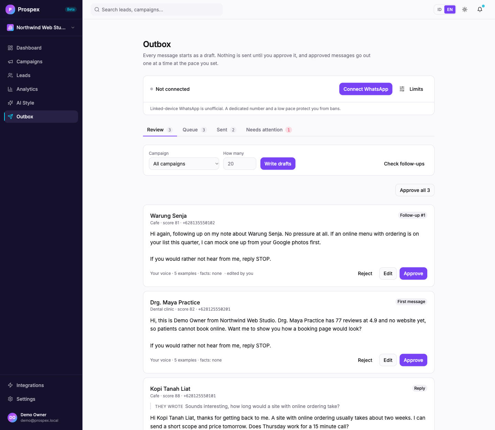
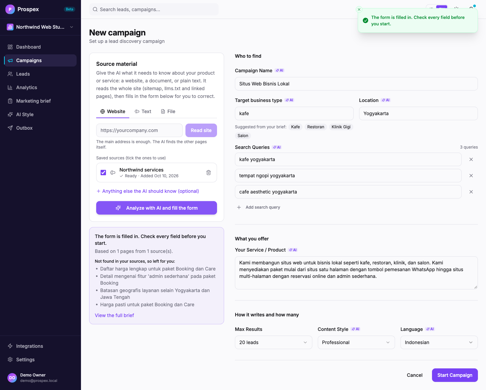
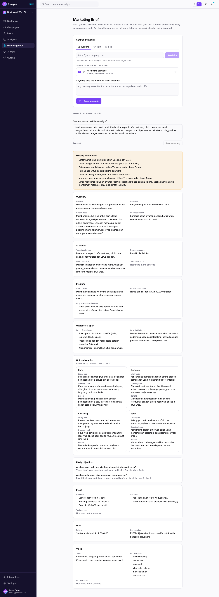
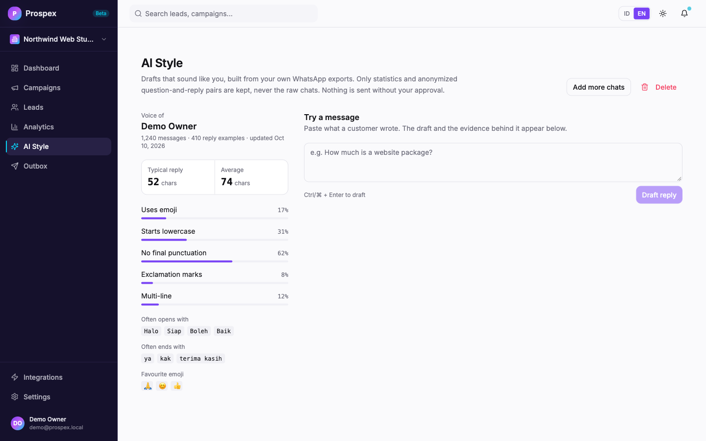
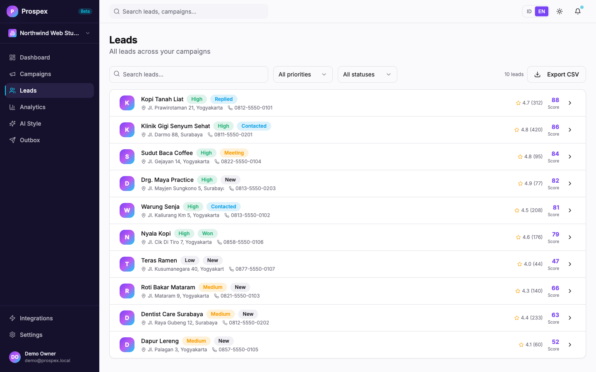
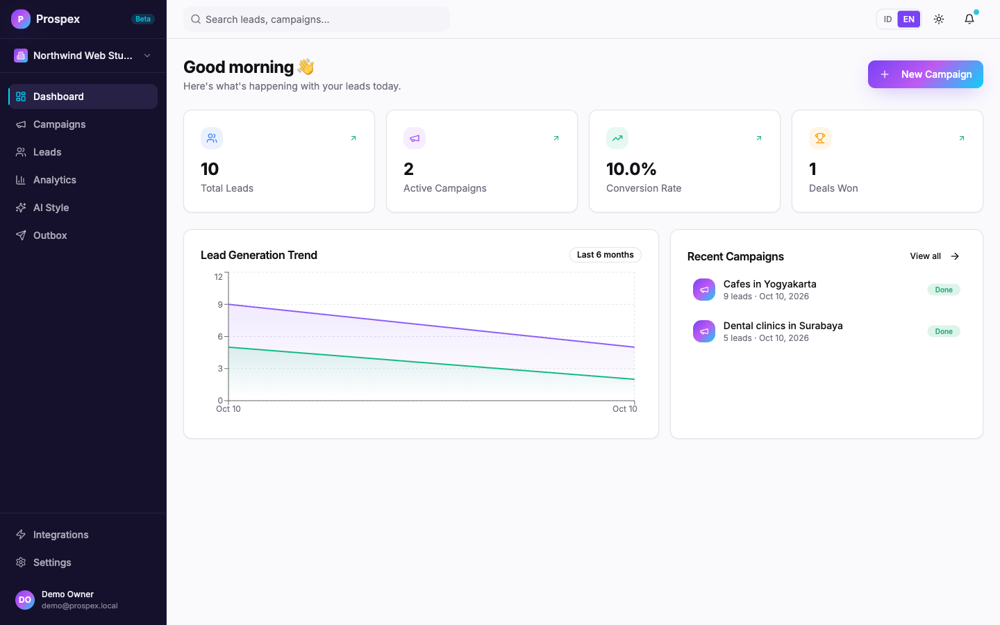

<div align="center">
  <h1>Prospex</h1>
  <p><strong>Open-source AI sales and marketing automation for local businesses.</strong></p>
<p>Discover business leads, enrich business information, draft personalized outreach with AI, review every message before sending, and manage follow-ups in one workflow.</p>
  <p><a href="https://alatpintar.id">🚀 Try Prospex</a> · <a href="#quickstart">⚙️ Self-host</a> · <a href="docs/whatsapp-outbox.md">📨 How sending works</a> · <a href="#roadmap">🗺️ Roadmap</a> · <a href="COMMERCIAL-LICENSE.md">📄 Commercial license</a></p>

  [](LICENSE)
  [](https://github.com/asiifdev/business-leads-ai-automation/stargazers)
  [](https://www.typescriptlang.org/)
  [](https://nextjs.org/)
  [](https://nestjs.com/)
  [](https://www.postgresql.org/)
</div>

<p align="center">
  
</p>

## Why Prospex exists

Selling to local businesses means hundreds of first messages and just as many follow-ups. Most tools either hide the work behind a bulk sender that gets numbers banned, or leave you to write everything yourself.

Prospex splits the job in two. The AI does the typing: it finds the leads, writes each draft, and drafts the replies and follow-ups. You do the deciding: every message waits in your Outbox until you approve it, and approved messages leave at a pace you set, one at a time.

> **Prefer not to run servers?** The hosted version at **[alatpintar.id](https://alatpintar.id)** runs Prospex for you. Self-hosting is free under the AGPL.

If Prospex is useful to you, a star helps other people find it.

## What you can do with it

| Step | What happens |
|------|--------------|
| **Understand your offer** | Give Prospex a website, a document (PDF, DOCX, Markdown, text) or pasted text. It reads the whole site (sitemap, `llms.txt`, linked pages), writes a Marketing Brief from what it finds, and fills in your campaign form for you to correct. What the sources do not say is listed as missing, not invented. |
| **Find** | Scrape Google Maps by business type and city with a headless browser, up to 2,000 leads per campaign. A typed city is searched where you asked (anchored on its coordinates, results outside about 50 km are dropped); "Seluruh Indonesia" becomes one search per city, biggest markets first, 40 or more results per search. Each lead carries the real Maps category, rating, review count, phone, website and coordinates. If scraping fails the campaign fails honestly: Prospex never makes up businesses. |
| **Score** | A 0 to 100 ranking from signals in the listing (reachable by phone, rating weighted by review count, review volume) plus an AI judgement of how well the business fits your offer, with the reason shown. No hard-coded industry or city weights. |
| **Draft** | The AI writes the first message from the lead's real data, your own style, the matching angle from your brief and your knowledge base. WhatsApp messages say who you are and what you offer in the first sentence, in plain words, then one relevant point and one easy question. Emails open with a greeting, end with "Salam," and can carry one link you set yourself. Three openings rotate across a campaign so you can compare reply rates. |
| **One message for many leads** | Prefer to write it once? In the Outbox, pick a kind of business (for example every kebaya rental), choose the leads, write the message or let the AI write one for that kind of business, and Prospex makes one draft per lead in the review list. `{nama}` and `{kategori}` fill in each lead's own name and category. No AI call per lead, so hundreds of drafts take a second. |
| **Approve** | Read, edit, approve or reject each draft in the Outbox, shown as the WhatsApp bubble it will be (bold, italics, lists, the link card, the attached file). Attach a file or a link preview if you want one. Nothing is sent before this step. |
| **Organise** | Every lead is reachable: paged lists, search by name, address, phone, website, email, category or area, province, city and district worked out from the coordinates, and a map that shows all leads. |
| **Send** | Approved messages go out through WhatsApp one at a time: hourly and daily caps, quiet hours, random gaps, and a typing indicator before each one. Email works the same way through your own SMTP account, with an unsubscribe link in every message, and refuses to send at all while that link would point to your own computer ([docs/email-channel.md](docs/email-channel.md)). |
| **Track to closing** | The Pipeline page shows every stage with deal value, replies waiting for you, leads that went quiet, follow-ups due, results per campaign and why deals were lost. A deal is never closed automatically; you mark it won or lost. |
| **Reply and follow up** | A reply is read against the whole conversation, including what you typed on your own phone. It is classified (interested, wants a meeting, asked the price, question, pointed to another contact, not now, not interested), moves the lead forward in the pipeline, cancels pending follow-ups, flags it as waiting for you, and creates a polite reply draft written as a seller approaching a business, not as a boss. A shop's automatic greeting is recognised and ignored. An approved reply goes out right away, ahead of the cold messages. Leads that stay silent get up to two follow-up drafts, after 3 and 5 days. A recipient who writes STOP is never contacted again and the lead is closed as lost. |

Every feature, its purpose, its limits and how far it has been verified: [docs/features.md](docs/features.md), [editions](docs/editions.md).

### Screenshots

<table>
  <tr>
    <td width="50%"><br><sub><b>New campaign.</b> Give it a website or documents; the AI fills the form and says what it could not find. Fields marked AI are yours to correct.</sub></td>
    <td width="50%"><br><sub><b>Marketing brief.</b> What you sell, to whom, what is proven, and what is still missing. Every section is editable.</sub></td>
  </tr>
  <tr>
    <td width="50%"><br><sub><b>Outbox.</b> Every message waits for your approval.</sub></td>
    <td width="50%"><br><sub><b>AI Style.</b> The voice learned from your own chat exports: reply length, emoji, punctuation, openers.</sub></td>
  </tr>
  <tr>
    <td width="50%"><br><sub><b>Leads.</b> Scored and filterable, with CRM status per lead.</sub></td>
    <td width="50%"><br><sub><b>Dashboard.</b> Leads, campaigns and conversion at a glance.</sub></td>
  </tr>
</table>

<sub>The data in these screenshots is fictional demo data (a made-up studio, made-up clients).</sub>

## Understanding your offer

Most outreach tools ask you to type a one-line description and hope. Prospex asks for the real material instead, then shows its work:

- **Sources**: a website (the main address is enough), pasted text, or files (`.pdf`, `.docx`, `.md`, `.txt`).
- **Whole-site reading**: besides the page you give, it follows `llms.txt`, the sitemap and the home page's links, up to 40 pages, and opens JavaScript-only pages in a real browser.
- **A brief with evidence rules**: numbers, customer names, testimonials and prices must appear in your sources or they are dropped and listed as missing.
- **You stay in charge**: the brief and the campaign form are editable, fields filled by the AI are marked, and anything you typed yourself is never overwritten.
- **Write once, reuse**: the analysis runs in the background (a small local model needs minutes; the page shows the step and you may leave it). A new campaign can then be filled instantly from the saved brief, with no new AI run. Analyse again only when your sources change.

[How it works, limits, and tips for local models](docs/marketing-brief.md).

## Writing in your own voice

AI Style is optional. If you use it, you export a few of your own WhatsApp chats (WhatsApp's official **Export chat** feature, `.txt` or `.zip`) and pick which participant is you. Prospex then:

- measures how you write: reply length, emoji, punctuation, how you open and close;
- stores anonymized pairs of *what the customer wrote* and *how you answered*, so it can show the model your real replies to similar questions;
- never stores the raw chats. Phone numbers, emails and links are replaced before anything is saved.

It is retrieval, not model training, so you can delete the profile at any time and nothing remains in a model. Everything can run on your machine with Ollama. [How it works, what it costs and how well it did in testing](docs/ai-style.md).

## Sending that protects your number

WhatsApp bans numbers that behave like bulk senders. Prospex is built around not behaving like one:

| Safeguard | Default |
|-----------|---------|
| Human approval before every message | Always on |
| Messages per hour | 10 (configurable 1 to 30) |
| Messages per day | 80 (configurable 1 to 200) |
| Quiet hours | 21:00 to 07:00 in your timezone |
| Gap between messages | Random, 0.6x to 1.4x of the hourly average |
| Typing indicator | Shown before each message, scaled to its length |
| Number check | Skips numbers that are not on WhatsApp, without counting them as failures |
| STOP handling | Cancels pending messages and blocks the number permanently |
| Opt-out line | Added to every first message and follow-up |
| Messages you type on your own phone | Recorded only for numbers that belong to a lead: the lead stops waiting for an answer and outdated drafts are withdrawn. They do not count toward the limits. |
| Replies to people who wrote to you | Not paced: an approved reply is sent on the next tick, ahead of the cold queue, and does not count toward the limits |
| Automatic greetings from shops | Recognised and ignored: no stage change, no reply draft |
| Circuit breaker | Pauses sending after 3 failures in a row |
| Crash safety | A message interrupted mid-send is marked failed, never resent automatically |

Pace decides the calendar. At the defaults (10 per hour, 80 per day) a list of 1,500 leads takes about 19 days. Raising the daily cap to 140, the most that 10 per hour allows between 07:00 and 21:00, shortens it to about 11 days. Start with a batch of 30 to 50 leads, watch the reply rate and the account, then scale up. Details and the reasoning are in [docs/whatsapp-outbox.md](docs/whatsapp-outbox.md).

**Two ways to connect WhatsApp.** Today Prospex connects as a linked device (Baileys), which works with any number but is unofficial, so use a dedicated business number. The official WhatsApp Business Cloud API is planned as a hosted-only feature (alatpintar.id subscribers), delivered as a separate private connector that is not built yet. The sender already talks to WhatsApp through one provider interface, and the Outbox settings show the option locked outside the hosted edition. See [docs/editions.md](docs/editions.md).

## Tech stack

| Layer | Technology |
|-------|-----------|
| **Frontend** | Next.js 16 (App Router), shadcn/ui, Tailwind CSS, Recharts, English and Indonesian interface |
| **Backend** | NestJS 10, Prisma ORM, REST API with Swagger |
| **Database** | PostgreSQL 16 with pgvector |
| **Queue** | BullMQ and Redis 7 for scraping jobs |
| **AI** | Any OpenAI-compatible provider: OpenAI, OpenRouter, Ollama |
| **Scraping and site reading** | Playwright with headless Chromium, behind a proxy that refuses private addresses |
| **Documents** | `unpdf` for PDF (in a worker thread), `fflate` for DOCX |
| **WhatsApp** | Baileys (linked device) |
| **Area lookup** | OpenStreetMap Nominatim (optional, point it at your own instance or turn it off) |
| **Monorepo** | Turborepo and pnpm workspaces |

<a id="quickstart"></a>
## Quickstart

You need [Node.js 20+](https://nodejs.org/), [pnpm 9+](https://pnpm.io/) and [Docker](https://www.docker.com/).

```bash
git clone https://github.com/asiifdev/business-leads-ai-automation.git
cd business-leads-ai-automation
pnpm install

cp .env.example apps/api/.env
cp .env.example packages/database/.env
# edit apps/api/.env: DATABASE_URL, JWT_SECRET, ENCRYPTION_KEY, OPENAI_*

docker compose up -d                       # PostgreSQL 16 with pgvector, and Redis
pnpm --filter @prospex/database db:deploy  # apply migrations
pnpm --filter @prospex/database exec prisma generate
pnpm --filter @prospex/api exec playwright install chromium   # the browser that scrapes Google Maps and reads websites

pnpm --filter @prospex/api dev             # API on :3001
pnpm --filter @prospex/web dev             # dashboard on :3000
```

Open [http://localhost:3000](http://localhost:3000), register, and create your first campaign. Swagger lives at [http://localhost:3001/api/docs](http://localhost:3001/api/docs).

Your first outreach, step by step:

1. **Campaigns, New campaign**: add your website or documents under *Source material* and press **Analyze with AI**. Check the filled form, then start the campaign. (You can also fill the form by hand.)
2. **AI Style** (optional): import a few of your WhatsApp chat exports.
3. **Outbox**: click **Connect WhatsApp** and scan the code with the phone (WhatsApp, Linked devices). Use a dedicated number.
4. **Outbox, Review**: choose the campaign, click **Write drafts**, then approve what you like.

The full walkthrough is in [docs/USER_GUIDE.md](docs/USER_GUIDE.md) (Indonesian).

### Choosing an AI provider

Any OpenAI-compatible endpoint works. Drafts need a chat model, and the style and knowledge features need an embedding model (`EMBEDDING_MODEL`). Switching the embedding model later means re-importing your chats and re-indexing your sources, because vectors from different models cannot be compared.

```env
# OpenAI
OPENAI_API_KEY=sk-...
OPENAI_MODEL=gpt-4o-mini
EMBEDDING_MODEL=text-embedding-3-small

# OpenRouter
OPENAI_API_KEY=sk-or-...
OPENAI_BASE_URL=https://openrouter.ai/api/v1
OPENAI_MODEL=anthropic/claude-haiku-4-5

# Ollama, fully local
OPENAI_API_KEY=ollama
OPENAI_BASE_URL=http://localhost:11434/v1
OPENAI_MODEL=gemma4
EMBEDDING_MODEL=qwen3-embedding
```

With `OPENAI_API_KEY` empty, scraping and rule-based scoring still work, and the AI features (drafts, AI Style, knowledge base) are off. Prospex does not fill the gap with canned text. A local model can take around 40 seconds per draft, so drafting runs in the background and the Outbox shows progress. Writing the Marketing Brief with a local model takes several minutes. For Ollama, a context length of 16,384 is enough (our biggest prompt is about 7,000 tokens) and uses far less memory than the 131,072 some installs default to; if it is sometimes slow or answers with a 500 error, check that nothing else is using the model at the same time, because Ollama serves one request at a time by default.

### Other settings

| Variable | Default | Purpose |
|----------|---------|---------|
| `OPENAI_REASONING_EFFORT` | empty | Set to `none` for reasoning models such as Ollama `gemma4` or `qwen3`: it switches off the thinking phase and is about ten times faster for these tasks. Leave empty for models that do not support it (for example `gpt-4o-mini`). |
| `BRIEF_SOURCE_CHARS` | `30000` | How much source text each pass of the Marketing Brief reads. Lower it if your model has a small context window. |
| `SCRAPER_MODE` | `live` | `fixture` returns clearly labelled test leads without phone numbers. For tests and demos only. |
| `PLAYWRIGHT_NO_SANDBOX` | unset | Set to `true` only where Chromium cannot create its sandbox (most containers; the Docker image sets it). Outside containers keep the sandbox on: the browser opens pages chosen by users. |
| `WA_AUTH_DIR` | `./.wa-auth` | Where linked-device sessions are stored. Mount it as a volume in production and treat it like a password. |
| `ATTACHMENTS_DIR` | `./.attachments` | Where files uploaded to send on WhatsApp are kept (one folder per workspace). Mount it as a volume in production. |
| `GEOCODER_URL` | `https://nominatim.openstreetmap.org` | Reverse-geocoding service used to work out each lead's province, city and district from its coordinates. The public one allows one request a second; point this at your own Nominatim to go faster. |
| `GEOCODER_USER_AGENT` | `Prospex/1.0 (self-hosted lead tool)` | Identifies you to that service; put a way to reach you if you use the public one. |
| `GEOCODER_DISABLED` | `false` | Set to `true` to turn the area lookup off (used in CI). |
| `REPLY_DRAFT_DELAY_MS` | `20000` | How long to wait after a prospect's last message before drafting an answer, so a burst of short messages gets one draft. |
| `PUBLIC_API_URL` | (localhost) | Public https base URL of the API (for example `https://api.example.com/api`). Unsubscribe links in emails point here. **Email sending is blocked, and approving email drafts is refused, while this is not a public https address**, because recipients could not use the link. |
| `ALLOW_LOCAL_UNSUBSCRIBE` | unset | Set to `true` only for local tests with your own mailbox, never to message real people. |
| `CORS_ORIGINS` | (app URL) | Comma-separated origins allowed to call the API, when the dashboard runs on another host. |
| `EMAIL_DISABLED` | `false` | Set to `true` to turn off the email sender (used in CI). |
| `EDITION` | `community` | `community` or `hosted`. See [docs/editions.md](docs/editions.md). |
| `WHATSAPP_DISABLED` | `false` | Set to `true` to turn off the sender, WhatsApp connections and follow-up scheduling (used in CI). |

## Production

```bash
cp .env.example .env     # strong passwords, real API keys
docker compose -f docker-compose.prod.yml up -d
```

This starts PostgreSQL with pgvector, Redis, the API, the dashboard and Nginx. Keep `WA_AUTH_DIR` on a persistent volume, otherwise every redeploy asks you to scan the code again. The compose file also mounts a volume for `ATTACHMENTS_DIR`, so uploaded files survive a redeploy.

## Project structure

```
prospex/
├── apps/
│   ├── api/              # NestJS API: scraper, leads, ai, messaging, auth
│   ├── web/              # Next.js dashboard (EN/ID)
│   └── marketing/        # Landing page
├── packages/
│   ├── database/         # Prisma schema and migrations
│   ├── types/            # Shared TypeScript types
│   └── config/           # Shared eslint and tsconfig
├── docs/                 # Guides, architecture, screenshots
└── docker-compose*.yml   # Local and production stacks
```

How the modules fit together: [docs/architecture.md](docs/architecture.md).

## API

Interactive docs at `/api/docs`. The main routes:

| Area | Endpoints |
|------|-----------|
| **Campaigns and scraping** | `GET/POST /api/campaigns`, `POST /api/scraper/campaigns/:id/start` |
| **Leads and CRM** | `GET /api/leads` (`q`, `priority`, `status`, `province`, `regency`, `district`, `campaignId`, `page`, `limit` up to 200), `GET /api/leads/map` (every lead with coordinates, same filters, up to 5,000), `GET /api/leads/regions` (province, city and district counts), `POST /api/leads/geo/backfill` (work out areas in the background), `POST /api/leads/:id/referral` (add a contact a lead passed you as a lead), `PATCH /api/leads/:id/crm`, `GET /api/analytics`, `GET /api/analytics/pipeline` |
| **Export** | `GET /api/export/leads/{csv,json,vcard}` |
| **AI Style** | `POST /api/style/inspect`, `POST /api/style/train`, `GET/DELETE /api/style/profile`, `POST /api/style/draft` |
| **Knowledge base** | `GET/POST /api/knowledge/sources`, `DELETE /api/knowledge/sources/:id`, `POST /api/knowledge/search` |
| **Marketing brief** | `GET /api/marketing/sources`, `POST .../sources/url`, `.../sources/text`, `.../sources/file`, `DELETE .../sources/:id`, `GET/PUT /api/marketing/brief`, `POST /api/marketing/brief/generate` (starts a background job), `GET /api/marketing/brief/generate/status` (progress, and the brief when done) |
| **Outbox** | `GET /api/messaging/outbox`, `POST /api/messaging/outbox/generate`, `POST .../approve`, `.../reject`, `.../cancel`, `PATCH .../:id` (text, attachment, link preview), `POST .../:id/retry` |
| **Files and link previews** | `POST/GET /api/messaging/attachments`, `DELETE /api/messaging/attachments/:id`, `POST /api/messaging/link-preview` |
| **Re-read conversations** | `POST /api/messaging/reclassify` (a preview by default; `{"apply": true}` applies it) |
| **One message for many leads** | `GET /api/messaging/templates/categories`, `GET .../templates/leads`, `POST .../templates/generate` (AI writes one message for a kind of business), `POST .../templates/apply` (one draft per selected lead) |
| **WhatsApp** | `GET /api/messaging/whatsapp`, `POST .../connect`, `POST .../disconnect`, `PATCH .../settings` |
| **Email** | `GET /api/email`, `PUT/DELETE /api/email/account`, `POST /api/email/account/test`, `POST /api/email/outbox/generate` |
| **Settings** | `GET/POST/DELETE /api/settings/api-keys`, `GET/POST /api/settings/integrations` |

## Development

```bash
pnpm install
pnpm --filter @prospex/api exec tsc --noEmit    # typecheck API
pnpm --filter @prospex/web exec tsc --noEmit    # typecheck web
pnpm --filter @prospex/api test                 # unit tests: chat parser, style stats, scoring, send policy, opt-out, spelling, brief, site reading, documents, reply understanding, conversation reading, WhatsApp formatting, attachments, link previews, areas
pnpm --filter @prospex/database db:studio       # Prisma Studio
```

`apps/api/scripts/pipeline-check.ts` exercises the sender, inbound handling, your own phone messages, outdated drafts, re-reading the pipeline and contacts you are pointed to, against a real database with a fake WhatsApp provider; `apps/api/scripts/attachment-check.ts` does the same for attachments and link previews. Both run in a throwaway workspace and limit the sender to it (`sender.tick(workspaceId)`), so they never touch another workspace's queue. `apps/api/scripts/reclassify-replies.ts` (dry run by default) corrects replies labelled wrongly by an older reading. `apps/api/scripts/eval-style.ts` compares generic drafts with drafts in your style on your own exports. See [CONTRIBUTING.md](CONTRIBUTING.md).

<a id="roadmap"></a>
## Roadmap

Done:

- [x] Google Maps discovery with real categories, honest scoring, CRM pipeline, analytics, export
- [x] Reply understanding and a pipeline view to follow leads until closing
- [x] One message for many leads: a template per kind of business, drafts for every selected lead
- [x] Email channel through your own SMTP account (sending only; replies are not read yet)
- [x] Marketing Brief from websites, PDF, DOCX, Markdown and text, with campaign autofill
- [x] Knowledge base with retrieval (pgvector)
- [x] AI Style: learn your voice from WhatsApp exports
- [x] Outbox: approve, edit, reject, then send one at a time with limits
- [x] WhatsApp through Baileys: pairing, replies as drafts, STOP handling, follow-up drafts
- [x] English and Indonesian interface on every screen
- [x] Several businesses per login: separate brief, AI Style, knowledge, WhatsApp number and AI key for each workspace
- [x] Leads you can always find again: paged lists, search by address, phone and area, province/city/district filters, a map with every lead
- [x] WhatsApp messages with formatting, files and link previews
- [x] Your own phone messages recorded for known leads, replies that read the whole conversation, one fresh draft that replaces an outdated one, contacts you are pointed to, and a way to re-read the pipeline

Next:

- [ ] Test sending at volume on a dedicated number (one real message and one real reply are verified; the pacing logic is tested with a stand-in WhatsApp)
- [ ] Official WhatsApp Business Cloud API provider
- [ ] Knowledge base screen (sources are managed from the Marketing brief page today)
- [ ] Edit-rate and reply-rate dashboard, to see whether drafts are improving (the opening used is already stored with every draft)
- [ ] Read email replies
- [ ] Quoted ("reply to this message") and edited WhatsApp messages: today a short answer is read without the message it quotes
- [ ] Hand a thread to a person when the prospect's need is outside your offer, instead of drafting
- [ ] Cover image and page count for PDFs sent as attachments
- [ ] Add your own answers to the knowledge base, so the next draft knows the price and terms you quoted by hand
- [ ] Senders whose number WhatsApp hides (LID): today their messages are listed on the Pipeline page but cannot be matched to a lead, so a STOP from one must be handled by hand. Baileys 7 would fix this
- [ ] More of marketing than outreach: email and other channels, content, social, ads
- [ ] Function-calling agent and MCP server, so AI agents can work your pipeline
- [ ] Proposals and invoices

Open an issue to vote on what comes next.

## License

Prospex is licensed under the **GNU AGPL-3.0-or-later**, see [LICENSE](LICENSE). Self-hosting and modifying are free. If you offer a modified version as a network service, you must publish your changes. A [commercial license](COMMERCIAL-LICENSE.md) is available if the AGPL does not fit your use.

Scraping websites and messaging people are regulated by the terms of those services and by privacy and anti-spam laws (GDPR, Indonesia's UU PDP and others). You are responsible for how you use this software. Read [DISCLAIMER.md](DISCLAIMER.md) before you contact anyone.

---

<div align="center">
  <sub>Built by <a href="https://github.com/asiifdev">asiifdev</a></sub>
</div>
